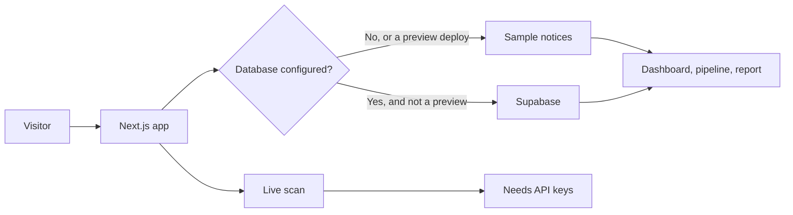
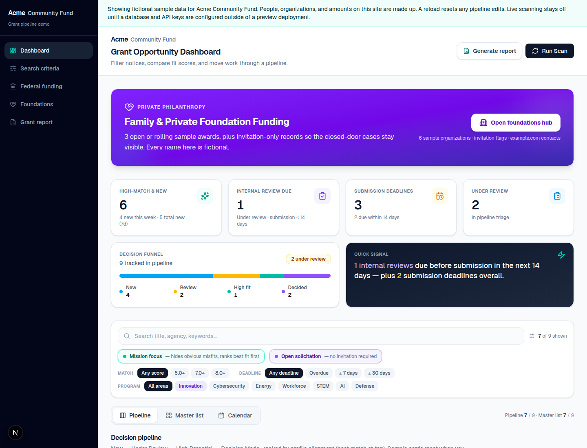
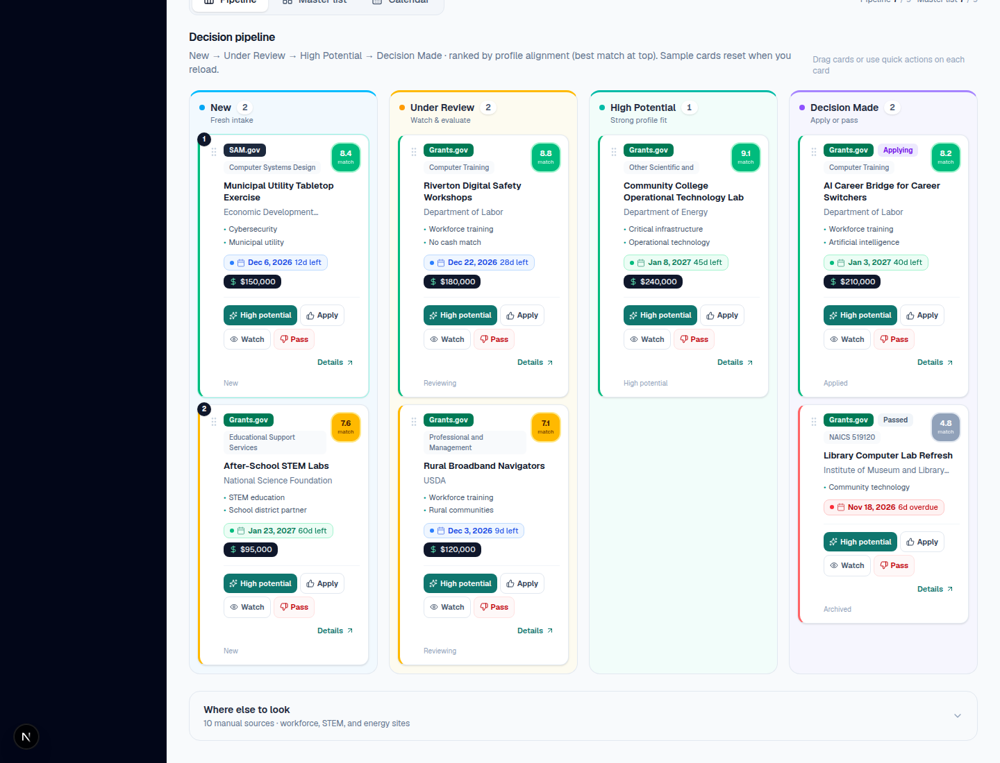
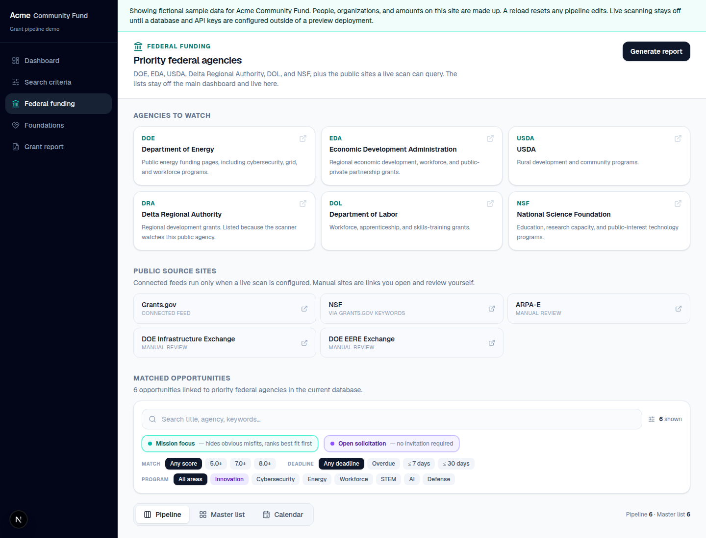
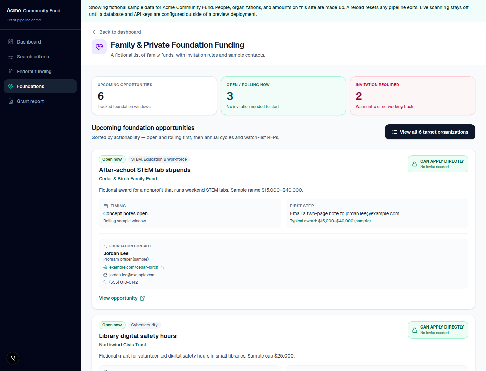
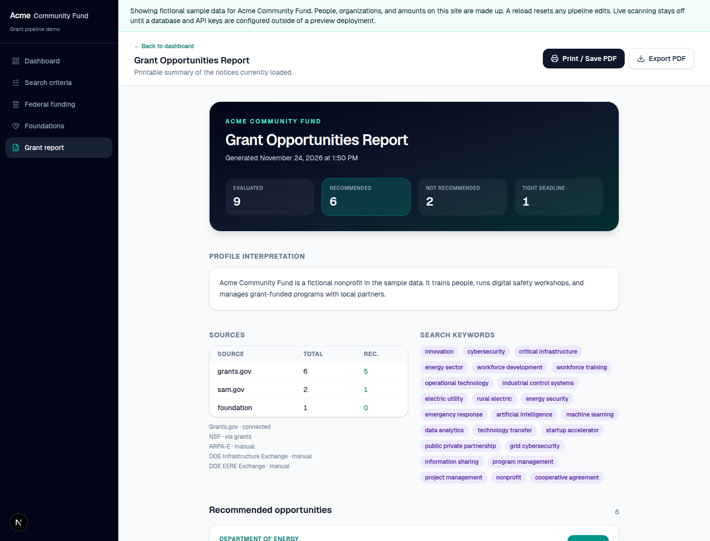
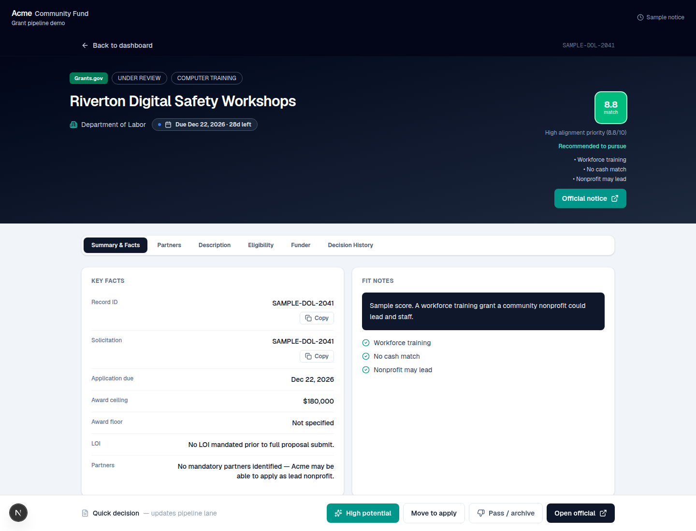

# Acme Grant Dashboard

A small dashboard for sorting grant notices. It is a portfolio piece built around a fictional nonprofit, Acme Community Fund. The people, organizations, and dollar amounts in the sample are made up.

## The problem

A nonprofit that applies for grants ends up with notices in email, spreadsheets, and half-finished folders. It is hard to see what is new, what is due soon, and what is worth a closer look.

## What I built

A web app that lists notices, scores them against a written profile, and lets you move them through a simple pipeline: New, Under Review, High Potential, and Decision Made. It also has a foundations list, a page of public federal funding sites, search profiles, and a printable report.

The copy and the sample records describe Acme Community Fund. That organization is fictional. The app does not submit applications, and it does not know whether a real funder would award anything.

## How it works

When no database is configured, the app reads fictional notices from `data/sample-opportunities.json` and a fictional foundations list in code. Fit scores in that mode are stored with the sample. They are not live model output.

If you provide database credentials outside a Vercel preview, the same screens read from Supabase. A live scan can then pull public notices and ask an external model to score them. Preview deployments stay on the sample so a public preview cannot attach to a private database.



The local score is a keyword check: workforce, cybersecurity, STEM, and program management raise it; janitorial work, construction, and invitation-only language lower it. Filters use that score, the deadline, and the text of the notice. A stored score, when one exists, is blended with the keyword score for sorting.

## Stack

- Next.js and React
- Tailwind CSS
- Optional Supabase for a live database
- Optional public-notice and model APIs for a live scan
- Vitest for the scoring, filter, and report rules

## What I learned

The useful part was not the scan. It was making the empty case the normal case: open the app with no secrets and still be able to click through every screen. I also learned to keep the scoring rules in plain functions so a test can say "a training grant ranks above a janitorial contract" without booting the site.

A preview deploy should not be able to reach a private database just because the hosting project still has old environment variables. Sample data is the default there on purpose.

## Screenshots













## Planned demo

Not deployed yet. When someone publishes this app, the intended address is https://acme-grant-dashboard.vercel.app. That site does not exist today. The plan is for it to show the same fictional sample, with no database credentials.

## Run it locally

```bash
npm install
npm run dev
```

Open http://localhost:3000. You do not need an env file.

Useful checks:

```bash
npm test
npm run lint
npm run build
```

To point the app at your own database, copy `.env.example` to `.env.local`, set both Supabase variables and `DASHBOARD_PASSWORD`, and leave `DATA_MODE` unset. Then:

```bash
npm run db:setup
npm run db:seed
```

`db:seed` upserts the fictional notices by notice id and replaces their score rows. It does not delete other rows. Running it again leaves the same sample set. Without `POSTGRES_URL`, the seed script exits without doing anything, because the app already serves that file.

A live scan also needs `SAM_GOV_API_KEY` and `XAI_API_KEY`. Without them the Scan button explains that it cannot run. Vercel preview deployments ignore live credentials and keep showing the sample.

## Credit

Built with AI coding tools (Cursor). Reviewed and tested by Robert Baker.
